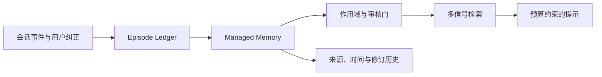

# Runtime Self-Learning

Runtime Self-Learning 是一个本地优先、可审计的长期记忆引擎，面向需要持续积累经验的 Agent 系统。

它关注的不是“保存更多文本”，而是让每条记忆都能回答四个问题：

- 这条信息从哪里来？
- 它适用于哪个项目和任务？
- 它现在是否仍然有效？
- 它为什么会被检索并进入下一轮上下文？

系统把会话中的稳定偏好、事实、工作流和错误经验整理成结构化记忆，再通过作用域、审核状态、时间有效性和提示预算控制使用范围。默认数据保存在本机，不依赖云端向量数据库，也不会把原始对话直接写进来源摘要。

## 核心能力

### 可追溯的记忆来源

每个学习回合可以生成受限的 episode 记录，保存任务摘要、工具摘要、结果信号、项目范围和 opaque session hash。记忆通过 `sourceRefs` 与 episode 关联，支持从“命中结果”回查到“形成原因”。来源记录不保存原始对话正文。

### 时态事实与修订链

事实同时记录有效时间和系统获知时间。新事实不会静默覆盖旧事实，而是建立替代关系并关闭旧事实的有效期；历史、修订和逻辑删除都可回查。

### 分层记忆

记忆分为 `core` 和 `archive` 两层：

- `core`：稳定偏好、有效事实和项目状态，可在预算范围内参与自动提示。
- `archive`：过程经验、历史信息和低频知识，通过显式检索使用。

这使自动提示保持短小、稳定、可解释，同时保留完整的长期资料。

### 多信号本地检索

检索由多个确定性信号组合而成：

- CJK 友好的 BM25；
- 多查询 RRF 融合；
- 显式实体、别名和关系；
- 字符 n-gram，用于中英混写、短词和部分拼写变化。

这些机制不是神经 embedding，也不会自动调用外部模型。模型整理和候选抽取属于可选能力，结果仍然进入审核链。

### 项目隔离与治理

项目范围是记忆的硬边界。未知范围不会退化为读取所有项目；导入、编辑、删除、批准和导出都经过作用域检查。写操作采用显式调用、审计记录和逻辑删除，导入必须先预览，事实替代必须经过明确批准。

## 工作流



## 两种独立发行形态

核心记忆模型保持一致，发行包、宿主协议、默认数据目录和安装方式分别维护。

| 发行形态 | 适用场景 | 安装入口 |
| --- | --- | --- |
| App Edition | 在支持 App SDK 的宿主中提供长期记忆、检索、审核和迁移能力 | [v6.2.0 Release](releases/tag/v6.2.0) |
| Harness Edition | 作为 DeepSeek Harness 原生 DSH bundle 注册记忆工具 | [`runtime-self-learning-harness`](https://github.com/326sun/runtime-self-learning-harness) |

Harness Edition 的安装命令：

```powershell
dsh plugin --profile web add github:326sun/runtime-self-learning-harness
```

安装后会注册 `memory_search`、`memory_list`、`memory_get`、`memory_history`、`memory_provenance`、`memory_episodes`、`memory_upsert`、`memory_delete`、`memory_approve`、`memory_export`、`memory_preview_import` 和 `memory_import`。

两种发行形态默认使用各自的数据目录，不会因为安装其中一种而接管另一种的运行数据。需要迁移时，应通过导出、预览和导入流程完成，而不是直接复制内部文件。

## 数据与隐私边界

- 默认本地存储，默认不访问网络。
- 原始对话正文不会进入 episode 来源摘要。
- 自动提示只使用作用域匹配、状态允许且处于 `core` 层的记忆。
- 删除是逻辑隐藏，不承诺从旧日志或已有外部备份中安全擦除。
- 模型整理默认关闭；启用后只生成受治理的候选结果。
- 没有引入云端向量服务、神经 embedding 数据库或自动批准的外部知识写入。

## 适合的场景

- 让 Agent 记住用户长期偏好，并保持可修改、可撤回；
- 为不同项目维护独立的事实、工作流和错误经验；
- 在长周期任务中保留“为什么这样做”的来源证据；
- 为团队或个人构建可审查的本地知识积累；
- 对导入数据、记忆替代和自动提示设置明确的人工边界。

## 当前验证范围

v6.2 App Edition 的本地回归为 1069 项测试，1064 项通过、5 项因 Windows symlink 权限跳过、0 项失败；构建、基准、性能、复杂度和依赖审计均通过。Harness Edition 已完成独立核心、原生工具注册和安装包检查；完整生产宿主的长时间运行、真实多轮对话、Node 26 archive smoke、生产迁移以及 macOS/Linux 验收仍属于后续验证范围。

## 开发

App Edition 的源码检查：

```powershell
npm ci --ignore-scripts
npm run check
npm test
npm run benchmark
npm run complexity:check
npm audit --audit-level=high
```

Harness Edition 是独立仓库，遵循 DeepSeek Harness 的 `dsh.bundle` / `cordis.patch.yml` 安装契约。两个发行仓库可以分别升级、测试和发布。

## 许可证

MIT License。
