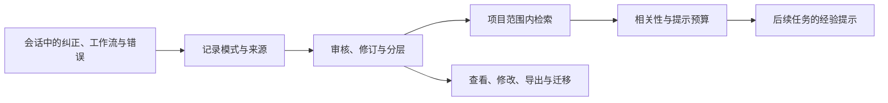

# Runtime Self-Learning

### 自学习与长期记忆

**让反复确认的偏好、项目事实和任务经验，成为 Agent 下一次工作时可用的上下文。**

[下载 v6.2.0](https://github.com/326sun/runtime-learner-hanako/releases/tag/v6.2.0) · [查看源码](https://github.com/326sun/runtime-learner-hanako/tree/v6.2.0) · [验证记录](https://github.com/326sun/runtime-learner-hanako/blob/v6.2.0/docs/ACCEPTANCE-v6.2.0.md)

Runtime Self-Learning 是面向 Hanako / HanaAgent 的本地自学习与记忆 App。它观察任务中的重复工作流、用户纠正和工具错误，将经验整理为可检索、可审核、可修订的记忆，并在后续任务开始前提供与当前项目相关的提示。

长期使用时，你可以看到系统记住了什么、经验从哪里来、适用于哪个项目，以及事实何时发生变化。自学习发生在记忆与提示层，积累的知识由你查看和管理。

## 为什么使用它

多轮协作经常需要重复说明输出习惯、项目约定和已经排查过的问题。把这些信息写入记忆后，还需要解决召回、过期、冲突和跨项目误用。这个 App 将这些环节放在同一条可检查的链路里。

| 你遇到的问题 | 插件提供的能力 |
| --- | --- |
| 每次新会话都要重新说明习惯 | 从纠正中积累偏好，经过审核与门槛判断后供后续任务使用 |
| 同一个问题反复排查 | 保存错误经验与处理线索，通过关键词和相关信号找回 |
| 多个项目的约定容易混用 | 依据宿主会话的项目范围限制检索与记忆操作 |
| 新事实出现后，旧信息仍在干扰 | 保留有效时间、修订历史与替代关系，让当前事实和历史事实各有位置 |
| 不清楚某条记忆为何形成 | 从记忆回查学习回合的来源摘要、工具摘要和结果信号 |
| 长期积累后，上下文越来越拥挤 | 核心记忆按相关性和预算提示，归档经验通过显式搜索调用 |

## 核心能力

### 从日常协作中积累经验

插件在获授权的会话事件中观察重复工作流、纠正和错误，记录模式及证据。稳定经验可以成为后续任务的提示；一次出现的信息仍受评分、重复次数和审核状态约束，待审偏好默认不进入自动提示。

例如，你可以逐步积累“文档使用中文”“这个项目的测试步骤”“某类工具错误应先检查哪些条件”等经验，再通过工具检查和修订它们。

### 记忆可以查看、修改与撤回

长期记忆支持偏好、事实、项目状态、工作流、错误和事件等类别。你可以搜索、读取正文、查看修订历史与来源，也可以明确要求新增、修改或逻辑删除某条记忆。

事实采用主语、关系、对象的结构，并保留有效时间与获知时间。更新冲突事实时，系统记录新旧替代关系，方便回查“当时是什么”和“现在是什么”。

### 按项目召回，按预算使用

项目范围来自当前宿主会话，工具参数不能任意切换到另一个项目读取其私有记忆。无法识别项目时，只允许符合条件的通用记忆进入相关检索和提示。

记忆分为两层：

| 层级 | 主要内容 | 使用方式 |
| --- | --- | --- |
| `core` | 稳定偏好、有效事实、项目状态 | 已批准且相关的条目可参与自动提示，受 Token 预算限制 |
| `archive` | 过程经验、历史信息、低频知识 | 按需显式检索，保留长期查阅价值 |

### 中文友好的本地检索

检索融合 CJK BM25、多查询 RRF、显式实体与别名关系、字符 n-gram 等信号，支持中文、英文和混合表达。实体关系来自记忆中明确保存的信息，字符信号帮助补充短词和部分拼写差异的召回。

默认检索在本机完成，无需额外部署向量数据库或配置 embedding 服务。

### 来源可追溯，迁移可预览

学习回合生成受限的 episode 来源记录，保存任务和工具摘要、项目范围、结果信号与不透明的会话哈希。记忆中的来源引用可回查到这些记录；episode 不保存原始对话正文。

备份使用版本化 JSON。导入遵循“预览 → 检查冲突 → 导入 → 逐条批准”的流程：预览与当前数据版本绑定，同 ID 内容不直接覆盖，导入项先进入待审核状态。

## 它如何工作



自动提示通过获授权的 `agent-before-start` 钩子加入后续任务。用户当前指令始终优先，经验提示需要结合实际任务判断。

## 安装与开始使用

当前公开 App 版本为 **v6.2.0**，面向 **HanaAgent 1.3.6-beta** 构建，采用 v2 App 格式。Manifest 声明的最低版本为 1.1.0；本次兼容审查基线是 1.3.6-beta，详细范围见[兼容审查](https://github.com/326sun/runtime-learner-hanako/blob/v6.2.0/docs/COMPATIBILITY-HANA-1.3.6-beta.md)。

1. 从 [Release](https://github.com/326sun/runtime-learner-hanako/releases/tag/v6.2.0) 下载 **`app-hanako-runtime-learner-6.2.0.zip`**，通过宿主的 App ZIP 导入入口安装。GitHub 自动生成的 Source code ZIP 用于源码查看。
2. 完成宿主的能力审查，并为需要使用的 Agent 启用 App。升级自旧 v1 插件时，先停用旧插件，保留原有学习数据。
3. 调用 `self_learning_stats` 查看版本、数据目录和授权状态，再调用 `self_learning_doctor` 检查基础运行情况。
4. 正常使用 Agent；需要时要求它搜索已有经验，或列出记忆并查看来源。自动提示需要授予 `app/hooks.agent-before-start`。

发布附件中的 `.entry.json` 用于市场登记。GitHub 发布与市集审核、索引更新是不同环节；市集暂未显示新版时，可通过上述 Release 获取 App 安装包。

后台计划需要显式调用 `self_learning_background` 的 `enable` 动作。模型整理和 LLM 抽取默认关闭，可在需要时单独开启；启用后台计划不会同时开启模型调用。

## 常用工具

| 工具 | 用途 |
| --- | --- |
| `self_learning_stats` | 查看数据规模、运行配置、数据路径与能力授权 |
| `self_learning_search` | 在当前项目范围内搜索已有经验 |
| `self_learning_memory` | 列表、搜索、正文、历史、来源与 episode 的只读查询 |
| `self_learning_memory_manage` | 新增、修改、逻辑删除、导出、预览导入与逐条批准 |
| `self_learning_report` | 查看学习情况与提案报告 |
| `self_learning_activity` | 查看最近学习活动 |
| `self_learning_control` | 审核、配置与本地审计等治理操作 |
| `self_learning_doctor` | 只读健康检查 |
| `self_learning_background` | 查看、显式启用或暂停后台计划 |

在当前项目中列出核心记忆，调用 `self_learning_memory`：

```json
{ "action": "list", "memoryLayer": "core", "limit": 20 }
```

搜索历史处理经验，调用同一只读工具：

```json
{ "action": "search", "query": "权限错误的处理经验", "memoryLayer": "all", "limit": 5 }
```

拿到实际记忆 ID 后查看来源：

```json
{ "action": "provenance", "id": "<实际记忆 ID>" }
```

修改、删除和批准应针对具体记忆明确提出。导入必须先取得 `preview_import` 返回的 `previewId`，再对同一份数据执行 `import`。

## 数据、权限与默认行为

程序和学习数据由宿主分别管理：

```text
<HANA_HOME>/
├── apps/hanako-runtime-learner/       # App 程序，安装目录只读
└── app-data/hanako-runtime-learner/   # 记忆、配置、日志、生成文件与导出
```

备份以 `self_learning_stats` 返回的实际 `dataDir` 为准。升级替换程序目录，卸载默认保留 App 数据。旧 v1 数据复制迁移的步骤见 [v2 迁移说明](https://github.com/326sun/runtime-learner-hanako/blob/v6.2.0/docs/V2_MIGRATION.md)，迁移工具默认预览，目标目录必须不存在或为空。

| 功能 | 默认行为 |
| --- | --- |
| 数据与检索 | 本地存储、本地检索；默认不调用模型、不直接联网 |
| 自动记忆提示 | 开启配置且获得 Hook 授权后，使用相关、已批准的核心记忆；预算默认 600 tokens |
| 待审核偏好 | 默认不参与自动提示 |
| 模型整理与 LLM 抽取 | 默认关闭；显式开启后使用宿主工具模型，LLM 抽取结果进入待审链 |
| 后台计划 | 用户显式启用后建立或恢复 |
| 激活技能注册表注入 | 默认关闭，属于单独配置的能力；不能等同于已完成自动技能效果验证 |
| 工作区自动修复与命令执行 | v2 App 适配层禁用 |

App 按功能声明工具暴露、用量读取、提示钩子、模型推理、任务管理和会话文件交付能力。缺少可选授权时，对应功能关闭，可在 stats 中查看。基础检索和记忆管理不依赖模型推理授权。

episode 的精简策略只针对来源摘要；其他学习日志与用户导出仍需按实际内容管理。逻辑删除会隐藏当前可用记录，旧日志及已有备份应单独处理。可选模型功能开启后，会将对应摘要交给宿主配置的工具模型处理。

## 版本与验证范围

本仓库维护 Hanako 产品；[Harness 产品](https://github.com/326sun/runtime-self-learning-harness)拥有独立仓库、安装包和发布节奏。

仓库 `main` 保留 v5.1.11 兼容基线，**v6.2.0 的源码、文档和安装包以对应 tag / Release 为准**。根目录旧 manifest 与安装脚本属于 v1，当前 v2 App 使用上文的 ZIP 安装流程。

以下为 v6.2.0 发布时记录的本地验证结果，依据[发布验收记录](https://github.com/326sun/runtime-learner-hanako/blob/v6.2.0/docs/ACCEPTANCE-v6.2.0.md)与[兼容审查](https://github.com/326sun/runtime-learner-hanako/blob/v6.2.0/docs/COMPATIBILITY-HANA-1.3.6-beta.md)：

| 检查 | 记录结果 |
| --- | --- |
| 自动化测试总数 | 1069 |
| 通过 / 跳过 / 失败 | 1064 / 5 / 0；跳过项受 Windows 符号链接权限限制 |
| 代码检查、复杂度检查与构建 | 通过 |
| 1.3.6-beta 官方 ZIP 静态校验 | 通过 |
| 当次依赖审计 | 0 漏洞 |

真实宿主多轮对话、Node 26 archive runtime smoke、后台任务跨重启、生产数据迁移及 macOS/Linux 验收尚未完成。上述自动化与静态检查结果不代表这些场景已经验收。

<details>
<summary>兼容基线的版本、默认配置与开发入口（v5.1.11）</summary>

`main` 中的根目录 package、v1 manifest 和发布检查仍维护 v5.1.11 兼容基线。下列标记记录该基线的历史回归：1001 tests；当前提交的检查结果以 [GitHub Actions](https://github.com/326sun/runtime-learner-hanako/actions/workflows/ci.yml) 为准。v6.2.0 App 的安装与验收记录见上文。


以下为共享学习核心的默认配置。v2 App 的宿主授权、后台计划显式启用和自动动作禁用规则仍按上文执行。

| 配置项 | 默认值 | 作用 |
| --- | --- | --- |
| `governanceProfile` | `balanced` | 使用均衡治理档位 |
| `autoInjectHighConfidence` | `true` | 允许满足门槛的记忆参与受预算限制的提示 |
| `autoApproveHighConfidence` | `true` | 允许满足门槛的稳定模式进入快速审核路径 |
| `minInjectScore` | `8` | 自动提示的最低评分 |
| `minInjectCount` | `2` | 进入自动提示候选所需的最少重复次数 |
| `includePendingPreferences` | `false` | 待审核偏好默认不进入提示 |
| `modelAdvisorEnabled` | `false` | 模型整理默认关闭 |
| `semanticSearchEnabled` | `false` | 可选语义搜索默认关闭 |
| `llmExtractionEnabled` | `false` | 模型抽取默认关闭 |
| `adaptiveThresholdsEnabled` | `false` | 默认使用固定策略阈值 |

维护兼容基线时，检出对应版本：

```powershell
git clone --branch v5.1.11 https://github.com/326sun/runtime-learner-hanako.git
```

</details>

## 开发与许可

检出当前 App 对应源码：

```powershell
git clone --branch v6.2.0 https://github.com/326sun/runtime-learner-hanako.git
cd runtime-learner-hanako
npm ci --ignore-scripts
npm run check
npm test
npm run build:app
```

App 打包与官方校验需要宿主开发工具，相关步骤见 [v2 迁移与验证说明](https://github.com/326sun/runtime-learner-hanako/blob/v6.2.0/docs/V2_MIGRATION.md)。

插件主体采用 [MIT License](LICENSE)。内联的官方 App SDK 采用 Apache-2.0，详见[第三方声明](https://github.com/326sun/runtime-learner-hanako/blob/v6.2.0/app/hanako-runtime-learner/THIRD_PARTY_NOTICES.md)。
